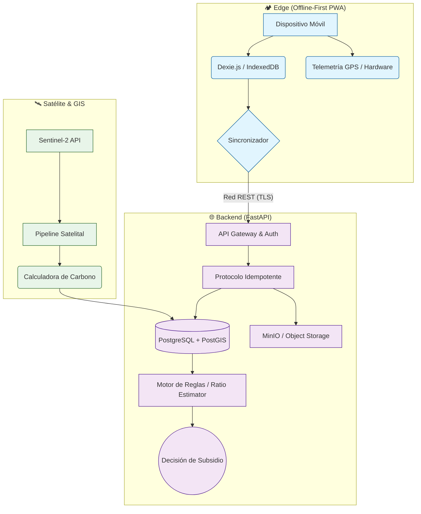
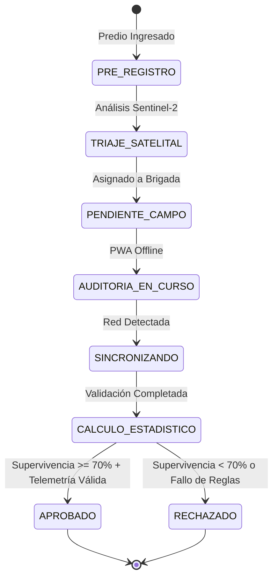

# 🌲 Sistema Probosque - Auditoría y Telemetría Ambiental

**Probosque** es una plataforma integral offline-first para la auditoría de predios, telemetría ambiental y toma de decisiones automatizada para la asignación de subsidios forestales. 

El sistema está diseñado para operar en entornos de nula conectividad (bosques, zonas rurales), garantizando la integridad de los datos mediante firmas criptográficas y un protocolo de sincronización idempotente.

---

## 🚀 Características Principales

1. **PWA Offline-First (Frontend):**
   - Captura de datos de campo y telemetría de dispositivos (GPS, salud de almacenamiento).
   - Base de datos local robusta utilizando IndexedDB (`Dexie.js`).
   - Sincronización diferida (Store & Forward) con el servidor cuando la conectividad se restablece.
   - Restricción por geocerca (Geofencing) en el dispositivo.

2. **Core Transaccional (Backend):**
   - API REST de alto rendimiento con FastAPI.
   - Arquitectura GIS con PostgreSQL y PostGIS.
   - Sincronización idempotente de datos en bruto mediante sistema de Retos (Challenges) y Firmas.
   - Bases de datos inmutables (Append-Only) para garantizar auditoría forense.

3. **Pipeline Satelital:**
   - Análisis de imágenes Sentinel-2 para triaje predictivo.
   - Cálculo automatizado de cobertura forestal (NDVI) y estimación de biomasa de carbono.
   - **Nota:** El satélite funciona como un semáforo de priorización, *no* como método directo de rechazo.

4. **Motor de Decisiones (Ratio Estimator):**
   - Cálculo estadístico automatizado de supervivencia forestal utilizando Estimadores de Razón y pruebas $t$-Student.
   - Arquitectura de estado restrictivo (Compuerta Booleana de Aprobación).
   - Ejecución autoritativa *exclusivamente* del lado del servidor.

---

## 🏗️ Arquitectura del Sistema

El sistema utiliza una arquitectura híbrida que separa la captura robusta offline de la inteligencia analítica central.



### Máquina de Estados de Auditoría



---

## 🛠️ Requisitos Previos

- **Docker y Docker Compose:** Para infraestructura (PostgreSQL, Redis, MinIO).
- **uv:** Gestor de paquetes y entornos virtuales ultra rápido para Python.
- **Node.js (v20+) y pnpm/npm:** Para la compilación de la PWA.
- **Git**

---

## 📦 Instalación y Despliegue Local

### 1. Levantar la Infraestructura

Inicia los contenedores de base de datos, caché y almacenamiento de objetos:

```bash
cd infra
docker-compose up -d
```

### 2. Configurar y Ejecutar el Backend

El backend utiliza `uv` para la gestión del entorno y dependencias.

```bash
cd backend

# Crear entorno virtual y sincronizar dependencias
uv venv
uv sync

# Ejecutar migraciones de base de datos (Alembic)
uv run alembic upgrade head

# Iniciar el servidor de desarrollo FastAPI
uv run fastapi dev app/main.py
```
> La API estará disponible en: `http://localhost:8000`  
> Documentación Swagger: `http://localhost:8000/docs`

### 3. Ejecutar el Frontend PWA

```bash
cd frontend

# Instalar dependencias
npm install

# Iniciar el servidor de desarrollo con soporte de host para pruebas de PWA en red local
npm run dev -- --host
```
> La PWA estará disponible en: `http://localhost:5173`

---

## 🔐 Protocolo de Sincronización y Seguridad

Para evitar ataques de replay (repetición) y alteraciones en los datos levantados en campo, el sistema implementa un protocolo robusto:

1. **Solicitud de Reto (Nonce):** La PWA solicita un string aleatorio firmado por el servidor antes de sincronizar.
2. **Cifrado y Firma:** La PWA empaqueta los datos de la auditoría y firma el paquete junto con el reto utilizando las llaves criptográficas del dispositivo.
3. **Idempotencia:** Cada carga utiliza un `idempotency_key`. Si la red falla durante el proceso, los reintentos no duplicarán información en la base de datos `append-only`.

---

## 📚 Documentación de Referencia

La documentación detallada se encuentra en la carpeta `docs/`. Recomendamos revisar los siguientes archivos para un entendimiento profundo del sistema:

- 🏗️ [Arquitectura Detallada](docs/architecture.md)
- 🧮 [Metodología de Campo y Estimación Estadística](docs/field_methodology.md)
- 🔄 [Protocolo de Sincronización Idempotente](docs/sync_protocol.md)
- ⚖️ [Motor de Reglas de Decisión](docs/decision_rules.md)

---

## 🧪 Testing

Para ejecutar la batería de pruebas:

**Backend (pytest):**
```bash
cd backend
uv run pytest
```

---

*Desarrollado con arquitectura sólida para garantizar el futuro verde de nuestros bosques.* 🌲
