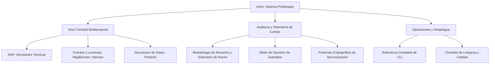

# Sistema Probosque - Documentación Técnica y Metodológica

Bienvenido a la documentación oficial del **Sistema Probosque**, una plataforma integral desarrollada para el monitoreo forestal, auditoría en campo y toma de decisiones geoespaciales en el Estado de México.

---

## Componentes del Ecosistema

El sistema integra dos iniciativas complementarias en una misma base de infraestructura:

### 1. Visor Forestal Multitemporal del Estado de México
Un visor público geoespacial para la consulta y análisis de la cobertura del suelo y pérdida arbórea histórica (2010–2025) en los 125 municipios oficiales:

- **Cobertura y Uso del Suelo:** MapBiomas México Colección 1.0 (clasificación en 15 clases, stocks anuales y matriz de transiciones).
- **Pérdida Arbórea Bruta:** Hansen Global Forest Change v1.13 (perturbación anual del dosel arbóreo con umbral de copa documentado).
- **Cartografía Oficial:** Marco Geoestadístico INEGI 2023 para el Estado de México y sus 125 demarcaciones.
- **Rendimiento Sub-segundo:** Estadísticas zonales precalculadas en PostgreSQL / PostGIS entregadas en menos de 100 ms vía FastAPI.
- **Motor de Mapas:** MapLibre GL JS con renderizado por GPU y cortinilla de comparación temporal sincronizada (*swipe*).

### 2. Plataforma de Auditoría y Asignación de Subsidios
Una solución desacoplada para brigadistas y auditores forestales en zonas de conectividad nula o intermitente:

- **PWA Offline-First:** Captura de unidades circulares de muestreo (500 m²) y evidencia fotográfica con telemetría de hardware en IndexedDB.
- **Sincronización Criptográfica:** Protocolo de reto/nonce con claves de idempotencia para garantizar la inmutabilidad y evitar ataques de repetición.
- **Estimación Estadística Servidor:** Estimador de Razón y pruebas t-Student ejecutadas exclusivamente en el backend para certificar el porcentaje de supervivencia.
- **Motor de Reglas Versionado:** Evaluación determinista de cumplimiento de criterios para asignación de pagos por servicios ambientales.

---

## Estructura de la Documentación

Esta plataforma de documentación organiza las especificaciones técnicas en cuatro secciones principales:

| Sección | Documento | Descripción |
|---|---|---|
| **Arquitectura General** | [Visión de Arquitectura](architecture.md) | Modelo desacoplado, máquina de estados y modelo anti-fraude |
| **Visor Forestal** | [Decisiones de Arquitectura (ADR)](decisions.md) | Registro de decisiones técnicas clave (MapLibre, PostGIS, MapBiomas) |
| **Visor Forestal** | [Fuentes de Datos y Licencias](sources_and_licenses.md) | Auditoría técnica y legal de MapBiomas, Hansen e INEGI |
| **Visor Forestal** | [Diccionario de Datos](data_dictionary.md) | Esquema relacional, tablas zonales e índices en PostgreSQL |
| **Auditoría y Campo** | [Metodología de Campo y Estadística](field_methodology.md) | Diseño muestral, estimador de razón e intervalos de confianza |
| **Auditoría y Campo** | [Motor de Reglas de Decisión](decision_rules.md) | Criterios de aprobación, umbrales y revisiones de subsidio |
| **Auditoría y Campo** | [Protocolo de Sincronización](sync_protocol.md) | Flujo paso a paso de sincronización offline e idempotencia |
| **Operaciones** | [Guía de Referencia CLI](cli_reference.md) | Catálogo de comandos para FastAPI, Celery, Alembic, Docker y pruebas |
| **Operaciones** | [Protocolo de Limpieza Pre-Lanzamiento](cleanup_protocol.md) | Lista de verificación de higiene para entrega en producción |

---

## Flujo de Navegación Rápida

---

## Pila Tecnológica

- **Backend:** Python 3.12+, FastAPI, SQLAlchemy 2.0, GeoAlchemy2, Alembic, Pydantic v2.
- **Base de Datos & GIS:** PostgreSQL 16 con PostGIS 3.4, Redis 7 (cola y caché).
- **Almacenamiento de Objetos:** MinIO (compatible S3).
- **Frontend & PWA:** React 19, TypeScript, Vite, Tailwind CSS, Dexie.js (IndexedDB), MapLibre GL JS.
- **Herramientas de Entorno:** uv (gestor de paquetes y entornos virtuales de alta velocidad).
- **Documentación:** MkDocs con tema Material, extensiones PyMdown y renderizado matemático con MathJax.
