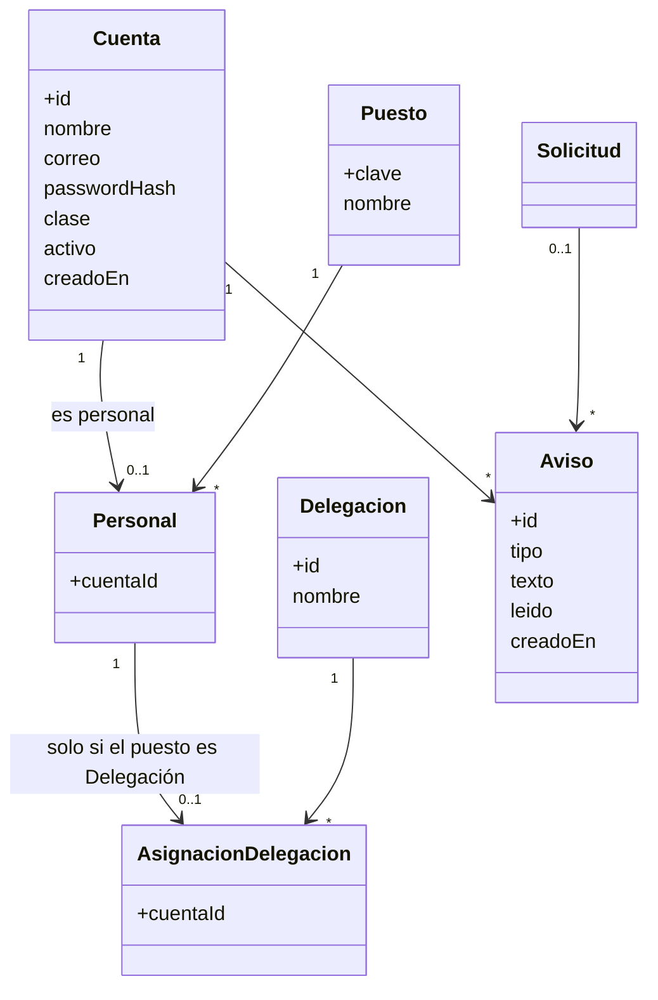
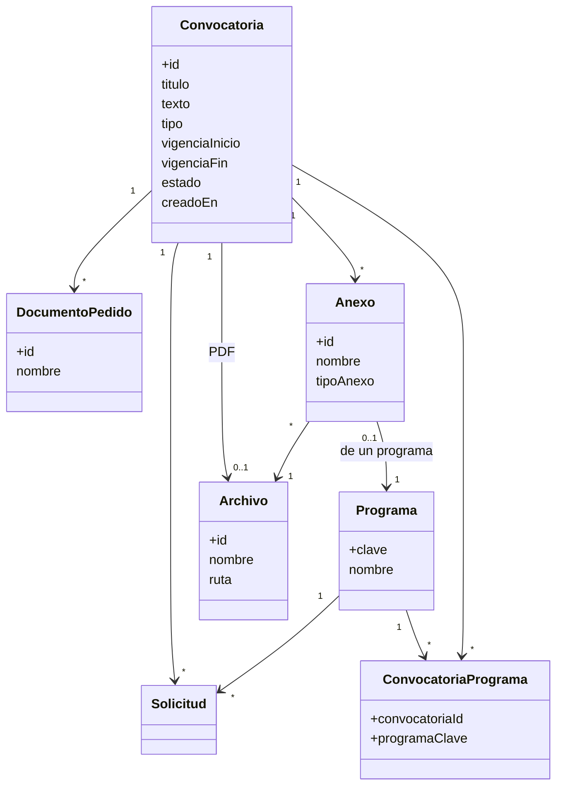
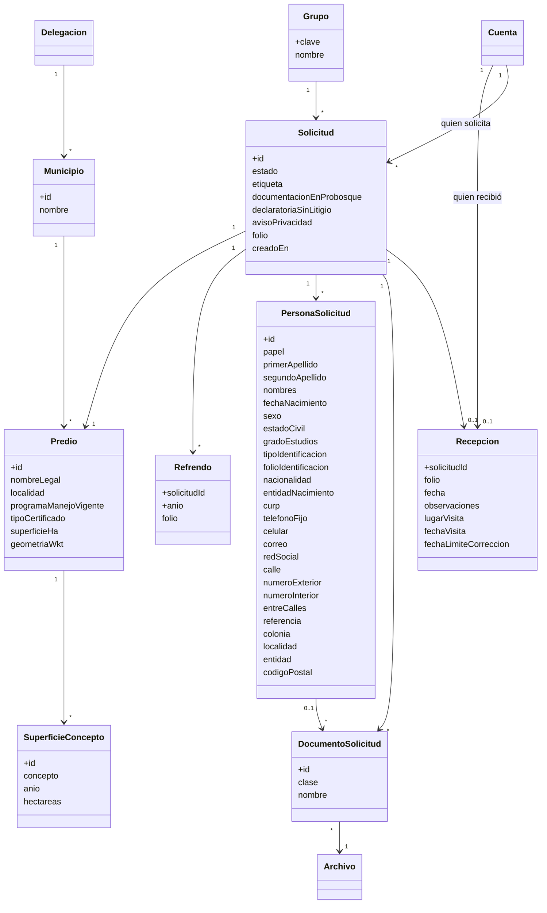
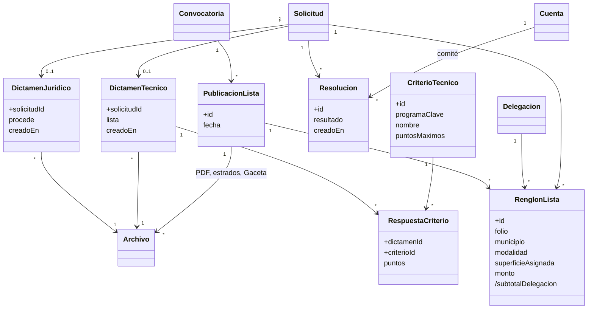
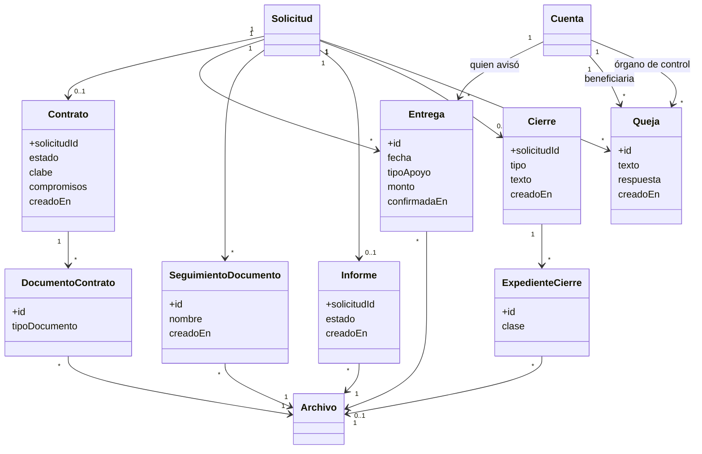

# Modelo lógico del trámite

Este modelo cubre el trámite de apoyos de PROBOSQUE 2026: cuentas, convocatorias, solicitudes, avisos, dictámenes, formalización, seguimiento, cierre y quejas. No incluye la calculadora de biomasa ni el visor forestal.

UML no tiene un diagrama de Chen. El diagrama de clases, con atributos y multiplicidad, es el modelo lógico. La asociación dibuja la relación; la llave foránea no se repite como atributo. Los atributos que empiezan con `/` se calculan y no se guardan.

El modelo está en tercera forma normal:

- Cada atributo depende de la llave de su clase y de toda la llave.
- Lo que se repite (personas, documentos, refrendos, superficies, renglones de la lista) es una clase hija.
- El programa vive en la solicitud. Dictamen, entrega y cierre no lo copian.
- Un catálogo (programa, delegación, puesto, grupo, municipio) no se escribe como texto suelto en cada hecho.

## Cuentas y avisos

`clase` es solicitante, personal o arranque. Solo puede existir una cuenta de arranque. El correo se repite entre solicitante y personal porque son dos cuentas; la llave candidata es correo más clase. La delegación no va en `Cuenta`: solo existe cuando el puesto es Delegación.

El aviso se lee dentro del sistema. El correo de la persona se guarda en su registro y no se usa para enviar.

## Convocatorias

`tipo` es Individual o General. Individual tiene exactamente un programa. General tiene uno o más, y cada solicitud elige uno. Esa regla no se puede expresar solo con la forma normal; la valida el servicio.

`DocumentoPedido` guarda el nombre. El archivo lo sube quien solicita, en `DocumentoSolicitud`.

`Anexo.tipoAnexo` es material o resultado publicado. La lista FO-PB-516 entra como resultado.

## Solicitud, predio y personas

`etiqueta` es Propietario, Poseedor, Núcleo Agrario, Sociedad u Otro. Propietario y Poseedor usan persona física. Sociedad usa persona jurídica. Núcleo Agrario usa el suyo. Otro no abre otro bloque de personas.

El domicilio de la FO-PB-502 depende de la persona, así que vive en `PersonaSolicitud`. No hay una tabla de domicilio compartida porque ninguna persona reutiliza el domicilio de otra.

`Refrendo` es un renglón por año (2023, 2024, 2025). Tres columnas de folio en la solicitud repetirían el mismo hecho.

`SuperficieConcepto` separa la sección III de la FO-PB-501 A. Todavía no está en las tablas: las historias de cada programa la van a llenar. Guardarla como columnas maderable, navideña y reforestación en el predio rompería la primera forma normal.

`Municipio` determina la delegación. Por eso la delegación no se copia en la solicitud. Hoy, mientras el catálogo de municipios no está cargado, la pantalla deja escribir el municipio y elegir una de las nueve delegaciones. Esa pareja es transitoria y el servicio la guarda en el predio y en la solicitud para no romper la bandeja.

La geometría es un solo valor WKT, o los tres archivos `.shp`, `.shx` y `.dbf` como `Archivo`. Un vértice suelto no sustituye al polígono.

## Dictamen, comité y lista

`lista` del dictamen técnico es factible con presupuesto, en espera o no factible. En el trámite general no hay puntaje. PSAHEM y Manejo Forestal usan `CriterioTecnico` y `RespuestaCriterio`, hasta 100 puntos, cuando se implementen esas historias.

Puede haber más de una `Resolucion` porque el comité puede pasar de lista de espera a beneficiario. El resultado vigente es la última. No se guarda otra vez el programa.

`RenglonLista` es la foto de la FO-PB-516. Se conserva aunque después cambie la solicitud, porque es el documento publicado. El subtotal por delegación se calcula al armar el PDF y no se guarda.

## Formalización, seguimiento y cierre

`DocumentoContrato.tipoDocumento` nombra el archivo sin inventar sus casillas: FO-PB-507, contrato hecho fuera, FO-PB-520-B, FO-PB-520 A, contrato con el asesor o la certificadora, cuenta mancomunada, anexo técnico.

`Entrega` es el aviso de una entrega ya hecha. No es un pago bancario. En PSAHEM el mismo aviso lo registra la fiduciaria: cheque nominativo, 70 por ciento, tres meses.

`ExpedienteCierre.clase` es pagos, predio o administrativo. Son tres renglones, no tres columnas.

Los indicadores de UIPPE no tienen tabla. Se cuentan las resoluciones por programa y por resultado. Guardar el conteo duplicaría un dato que ya está en `Resolucion`.

## Qué hay hoy en las tablas

| Hecho del modelo | Dónde está ahora | Qué falta |
|---|---|---|
| Cuenta, puesto y delegación | `cuenta.puesto` y `cuenta.delegacion` en el orquestador | La delegación sigue en la cuenta. El modelo la separa cuando el puesto es Delegación. No se mueve en esta pasada. |
| Convocatoria, programas, documentos, anexos | Servicio de convocatorias | Faltaba el tipo Individual o General. Esta pasada lo agrega. |
| Solicitud y personas | Servicio de expediente | La persona solo tenía nombre e identificación. Esta pasada agrega la FO-PB-502, el predio, el grupo, los refrendos y la declaratoria. |
| Nombre del titular copiado en la solicitud | `solicitud.nombre_solicitante` | Se sigue llenando desde el titular para la bandeja. La fuente es la persona. |
| Recepción | Folio y fecha límite en la solicitud | Lugar y fecha de visita todavía no son columnas propias. |
| Dictamen | `procede` en jurídico y técnico | El técnico del modelo usa tres listas, no un sí o no. No se cambia hasta implementar esa pantalla. |
| Resolución, contrato, entrega, informe, cierre, queja | Servicios de dictaminación, formalización y cierre | Varias tablas copian `programa`. El modelo no lo copia. No se reescriben en esta pasada. |
| Lista FO-PB-516, criterios, superficie por concepto | No hay tabla | Quedan dibujados para las historias que siguen. |
